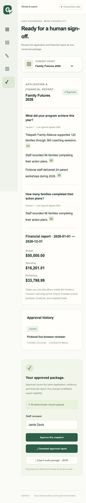

# All three parts: live browser acceptance — November 8, 2026

**PASS.** The production app completed a real OpenAI browser journey at 9:21 a.m. Eastern using fictional evidence and a separate SQLite database. The [receipt](qa/2026-11-08/live-browser-receipt.json) records the tested application revision, test/config hashes, exact cents, and approved snapshot hash.

The browser performed these actions through the app's screens:

1. Imported a fictional source and approved its workshop fact. A second source line containing an unsupported instruction/statistic stayed pending.
2. Enabled **Use OpenAI Agents SDK**, then generated q1 and q2 through the workspace API. Both used real `gpt-4.1-mini` calls; the app's three-tool requirement and deterministic validator passed. The drafts contained three and one approved claims respectively, with no validation errors. The pending instruction/statistic did not enter the answers or sealed evidence appendix.
3. Opened a claim citation, imported a $1.01 fictional CSV expense, and confirmed that unallocated spending blocked approval.
4. Allocated $0.50 then $0.51 to Program supplies. The UI preserved the category and refreshed the remaining amount. Spending became **$16,201.01**, leaving **$33,798.99**.
5. Rearranged the dashboard, reloaded, and verified saved panel order and the reconciled balance.
6. Approved the live drafts and report in the UI, then downloaded actual JSON and HTML files. Both contained the approved values and snapshot hash; both drafts retained their live-generation mode.
7. Reloaded the approved package at a 360-pixel phone width, verified no page-wide overflow, and captured the approved state.
8. Edited a claim to an unsupported statement. Approval and export became unavailable; the UI displayed the API's blocked-export message and the export endpoint returned 409. The previous approved snapshot remained unchanged and its approval was durably marked invalidated.

No unhandled client errors occurred. The key stayed server-side, and the private `.env.local` and test databases remain Git-ignored. Automatic traces, videos, and failure screenshots are disabled for this opt-in live runner; only explicit successful states were captured. Screenshots were inspected after the run.

The same application revision also passed **9 fixture browser tests**, **39 offline engine/SDK/component tests**, production build, and typecheck. The two server-dependent JSDOM cases remain opt-in and were skipped by the default unit command. No application source changes were needed for this live acceptance pass.



## Reproduce deliberately

Configure a valid key privately and explicitly authorize API usage before running:

```sh
npm run build
GRANTPROOF_ALLOW_LIVE_BROWSER=1 ./node_modules/.bin/playwright test --config playwright.live.config.ts
```

This separate configuration runs one test with two paid generations, no automatic retries, a loopback production server on port 4322, and only `data/playwright-live.sqlite`. It refuses to reuse an existing server or run without opt-in. Regular `npm run test:e2e` stays fixture-only and does not discover the live test directory. The live runner's timeout and the agent's turn/time limits are not a dollar spending cap.

This is acceptance evidence for the tested Chromium journey and synthetic dataset. It does not establish reliability across every model output, Safari, physical phones, public hosting, or real nonprofit data.
