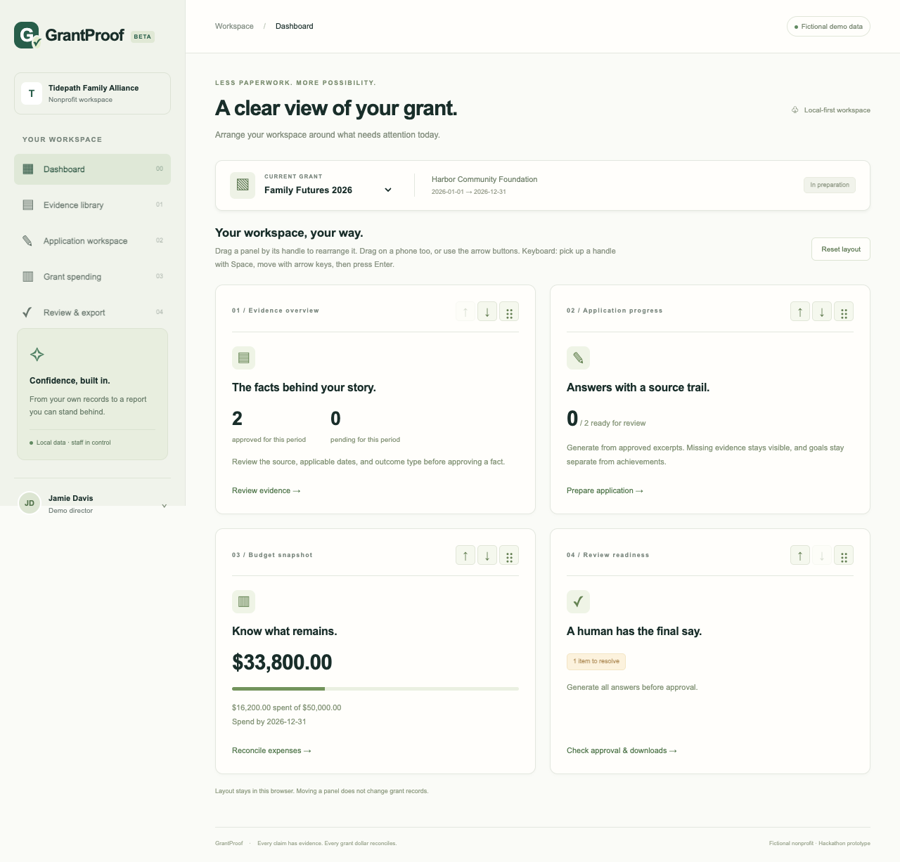
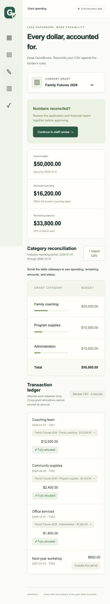
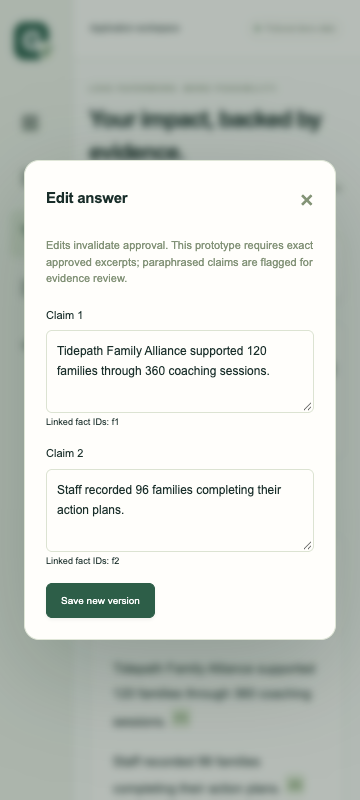

# Visual and integration checks — November 7, 2026

Parts 1 and 2 were checked together on the integration branch using fictional data and a local production build. Playwright was explicitly authorized for this review. No live AI call, real records, public deployment, or funder submission was involved.

## Screens and layout

Captured 11 states at each of three Chromium viewport sizes: desktop 1280 × 720, emulated Pixel 7 412 × 839, and compact phone 360 × 800. The states cover the dashboard, evidence, empty and generated applications, spending, blocked and approved review, citation dialog, answer editor, source import, and CSV import. Screenshots were inspected for hierarchy, wrapping, controls, dialogs, and financial totals. Representative screenshots are committed below; the full 33-image set has a SHA-256 manifest in `docs/qa/2026-11-07/screenshot-manifest.json` and is preserved locally in `GrantProof-Visual-QA-20261107` on the Desktop.

The review found cramped mobile money summaries. Spending and review totals now stack on phones so each currency amount stays inside its card. The category table remains horizontally scrollable, with a visible phone hint and a focusable, named region for keyboard scrolling. Browser assertions check page width and currency containment at every captured state.

## Combined behavior

`npm run test:e2e` passed all **7 browser tests** against its isolated fictional database:

- Desktop and Pixel 7 complete the synthetic source/CSV journey, generate cited answers, reconcile both grants, approve a snapshot, download actual JSON and HTML files, and block export after an unsupported edit.
- Desktop and Pixel 7 reject an export from a stale reviewer session after another session revokes cited evidence.
- All three viewports cover the 11 screenshot states, real mouse drag or Chromium touch input, saved layout after reload, reset, keyboard scrolling of the mobile category table, and absence of unhandled client errors. Existing journey tests also cover keyboard dashboard movement and saved order.

The initial mobile drag test aimed near a panel edge that moved during edge scrolling. Targeting its center made the gesture stable; no touch-handler code change was needed.

`npm test` passed **30 engine/acceptance tests and 3 standalone Part 1 component tests**; its two server-dependent JSDOM tests were skipped in this invocation. Both had passed separately on the preceding integration revision, and the current browser tests exercise the combined production app. Production build and `npm run typecheck` passed after the layout changes.

Reproduce with `npm ci`, installed Google Chrome, and `npm run test:e2e`. The runner uses loopback port 4318, refuses to reuse an existing server, and resets only `data/playwright.sqlite`. Screenshots are written to ignored `test-results/` directories. Review them again when layout changes; these checks are functional assertions and screenshot inspection, not pixel-baseline comparisons.

This completes the scoped Chromium visual review. Physical-device/Safari behavior and live OpenAI generation have not been tested.

## Miami neighborhood collection — November 8 follow-up

Three original visual variants now use real neighborhood references: **Wynwood** (neon mural geometry), **South Beach** (pastels and Art Deco lines), and **Little Havana** (warm storefronts and Calle Ocho). These are original decorative illustrations, not photographs of specific buildings or claims about real nonprofit customers. The original theme remains available.

The style references are grounded in the official tourism descriptions of [Wynwood](https://www.miamiandbeaches.com/neighborhoods/wynwood), [the Art Deco District](https://www.miamiandbeaches.com/l/attractions/art-deco-district/2116), and [Calle Ocho](https://www.miamiandbeaches.com/things-to-do/attractions/explore-calle-ocho-in-little-havana).

The header's **Workspace theme** menu saves the selection locally and restores it before paint. Each palette covers navigation, report cards, forms, tables, evidence filters, dialogs, and approval/error states. A new **Try the demo** dialog walks a first-time user through evidence, drafts, spending, and approval/export. Screenshots were inspected on desktop and phone layouts; the larger hero's native-drag check now targets the visible panel header while retaining its actual pointer drag and saved-order assertions.

Validation: all **12 fixture browser tests**, **39 offline checks**, production build, and typecheck passed. Two server-dependent JSDOM cases remain opt-in. No extra paid API calls were made for the neighborhood design work. Screenshots and their manifest are under `docs/qa/miami-themes/`; a local comparison gallery is in `GrantProof-Miami-Variations` on the Desktop. See [the updated demo plan](DEMO.md) for the contest research, opening pitch, and remaining owner steps.
